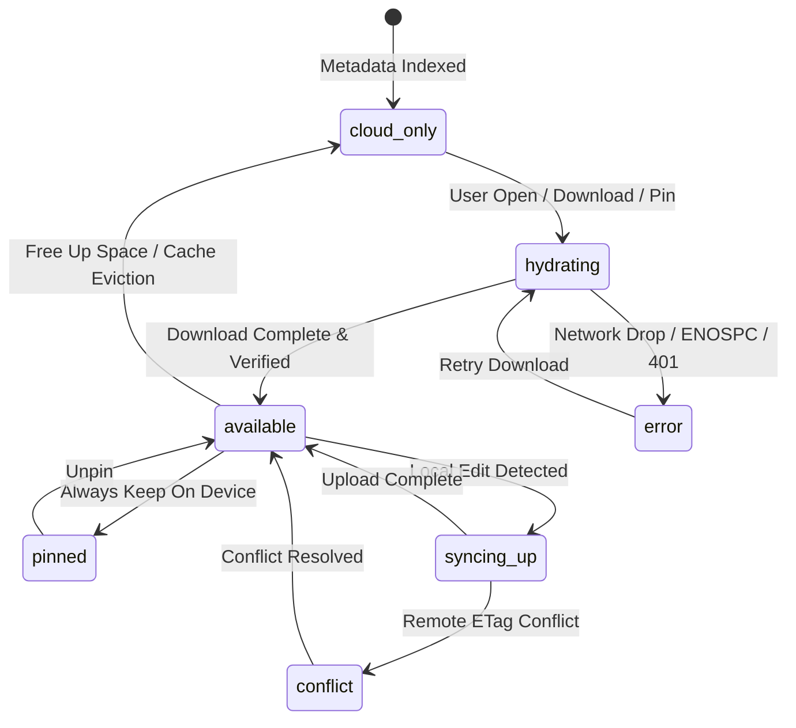

# AR Files - Technical Architecture Document

## 1. Executive Summary & Design Vision

**AR Files** is a cloud-native desktop file manager designed for Fedora Workstation (GNOME 50 / Libadwaita). Its core mission is to replace traditional file managers like Nautilus for users who mount cloud drives (Google Drive, OneDrive, WebDAV, SFTP, S3-compatible).

### The Fundamental Problem
Traditional desktop file managers (e.g. Nautilus via GVfs/GOA) perform synchronous `stat`, directory listing, and metadata queries on the main execution/UI thread. When a cloud connection experiences latency, rate limiting, token expiration, or network loss, the file manager freezes and locks up the desktop shell.

### The Architectural Guarantee
**AR Files makes UI freezes architecturally impossible.**
Opening a folder never executes blocking network I/O or hanging disk calls. Browsing, navigating, searching, and sorting are instantaneous operations executed against a local SQLite WAL database.

---

## 2. Core Architectural Invariants

### 1. Local-First Metadata Engine
- All cloud folder trees, file metadata (name, byte size, mtime, ctime, mime type, provider ID, ETag/content hash, parent hierarchy, sync version, and file state) live in a high-performance local SQLite database.
- SQLite is configured with Write-Ahead Logging (`PRAGMA journal_mode=WAL`), `PRAGMA synchronous=NORMAL`, `PRAGMA busy_timeout=5000`, and foreign key enforcement.
- Browsing, sorting, searching, and filtering query only local indexes:
  - `idx_entries_parent_name` (`parent_id`, `name`)
  - `idx_entries_parent_mtime` (`parent_id`, `mtime`)
  - `idx_entries_state` (`state`)
  - Full-Text Search via SQLite FTS5 (`entries_fts`) with unicode61 tokenizer.

### 2. Stale-While-Revalidate Sync Loop
- Folders open immediately by querying cached records from SQLite (<15ms).
- A background Tokio worker reconciles changes via the provider's delta feed (e.g., Google Drive `changes` API or OneDrive delta token).
- Any detected changes are applied atomically in a single SQLite transaction, and delta diffs (`added`, `changed`, `removed`) stream to the UI without resetting the user's scroll position or losing active selections.
- A subtle Libadwaita spinning indicator shows sync activity; no modal or blocking spinners ever display.

### 3. Sparse On-Demand Hydration
- Files from cloud storage initially exist as zero-block placeholders on local disk, with remote size preserved in metadata.
- Double-clicking or an external application reading the file initiates asynchronous streaming hydration.
- Ranged chunk downloads write into a temporary file (`.part`), verified against provider checksums (SHA-256 or MD5), and atomically renamed into place via `rename(temp, final)`.
- Resumable from byte offsets upon network recovery.

### 4. Asynchronous Everything & Non-Blocking IPC
- The Tauri main thread and UI event loop never perform synchronous file I/O or network calls.
- Heavy operations execute in Tokio asynchronous tasks or a dedicated bounded `spawn_blocking` pool.
- Commands return immediately with a job ID; operational updates and telemetry arrive via streaming events and channels.
- Cursor and window-based pagination ensure IPC payloads never exceed 1 MB.

### 5. Resilient External Calls & Circuit Breakers
- Every remote or local external call has strict deadlines, exponential backoff with jitter, and circuit breakers.
- Local filesystem calls (such as `stat` or `readdir` on dead NFS/SMB/FUSE mounts) run through `HangProofFs` with a 50ms deadline, marking unresponsive mounts without hanging worker threads.

### 6. Crash Safety & Operations Journal
- Multi-step operations (copy, move, delete, batch rename, upload, hydration) are journaled in the `operations_journal` table prior to execution.
- If the application is terminated abruptly (SIGKILL or power loss), the engine scans pending journal records on boot and cleanly resumes or rolls back incomplete operations.

---

## 3. Crate Architecture & System Boundaries

```
AR-Files/
├── crates/
│   ├── core/         # Domain models, FileState state machine, QuerySpec, typed errors (thiserror)
│   ├── db/           # SQLite engine (sqlx/rusqlite, WAL, migrations, FTS5 search, indexes)
│   ├── providers/    # CloudProvider async trait, capabilities, Google Drive, OneDrive, OpenDAL/Rclone
│   ├── sync/         # HydrationManager (.part resume), CacheManager, DeltaEngine, ConflictDetector
│   ├── ops/          # OperationsManager (atomic copy, move, rename, trash, batch, undo/redo)
│   ├── platform/     # Freedesktop Trash spec, .desktop parsing, Open With, XDG thumbnails, zbus D-Bus
│   └── vfs/          # FUSE3 virtual filesystem, inode mapper, sparse getattr, streaming reads
├── src-tauri/        # Tauri 2 runtime integration, IPC commands, event dispatch, system tray
└── ui/               # React 18, TypeScript strict, Zustand store, TanStack Virtual, Libadwaita CSS
```

---

## 4. File State Machine

Each cloud file exists in exactly one deterministic state:



---

## 5. FUSE Virtual Filesystem (`crates/vfs`)

AR Files implements a Linux FUSE3 virtual filesystem mounted at `~/CloudDrives/<Account_Name>`:
1. **Zero-Block Placeholders**: External CLI tools (`ls -l`, `cat`, `grep`) and desktop apps (LibreOffice, VS Code, GIMP) see real file names, permissions, and byte sizes, but zero blocks allocated on disk until opened.
2. **Streaming Reads**: When an external process reads a placeholder, `VfsDriver` intercepts the `read()` call, requests bytes from the `HydrationManager` with high priority, streams chunks to the caller, and hydrates the local cache transparently.
3. **Clean Unmount**: Clean unmounting with `fusermount3 -u` on application exit, with signal traps handling SIGTERM/SIGINT.

---

## 6. D-Bus & Freedesktop Integration (`crates/platform`)

1. **`org.freedesktop.FileManager1`**:
   - Implemented using `zbus`.
   - Handles `ShowFolders`, `ShowItems`, `ShowItemProperties`.
   - Allows browser downloads ("Show in folder") and other desktop apps to summon AR Files windows.
2. **XDG Trash Specification**:
   - Manages `$XDG_DATA_HOME/Trash` (`files/` and `info/*.trashinfo`).
   - Supports atomic trash, restore, and permanent deletion.
3. **Open With & Mimeapps**:
   - Parses system `.desktop` files from `/usr/share/applications` and `~/.local/share/applications`.
   - Reads `mimeapps.list` to determine default handler and launches processes with proper Exec field codes (`%f`, `%F`, `%u`, `%U`).
4. **Secret Service API**:
   - Stores OAuth access and refresh tokens securely in GNOME Keyring via the `keyring` crate.
   - Tokens never touch plain text files, environment variables, or logs.

---

## 7. Frontend Architecture (`ui/`)

- **Rendering Engine**: React 18 with TypeScript strict mode, styled with pure CSS tokens adhering to GNOME 50 / Libadwaita Human Interface Guidelines.
- **Virtualization**: `@tanstack/react-virtual` renders only visible rows in 100,000+ item folders, ensuring 60fps scrolling and negligible DOM footprint.
- **State Store**: Zustand store (`useExplorerStore`) manages active tabs, navigation breadcrumbs, selection sets, cached entries, and cloud account states.
- **Accessibility (A11y)**: WAI-ARIA grid, row, gridcell, and toolbar roles; `:focus-visible` styling; full keyboard navigation without mouse reliance.
- **Internationalization (i18n)**: Native multilingual translation engine supporting English, German, French, Spanish, Japanese, and Hindi with localized dates and number formats via `Intl`.
